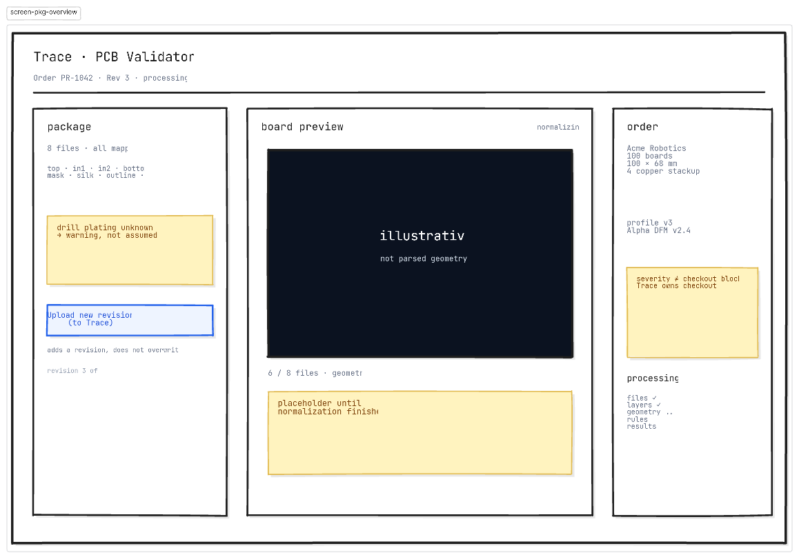
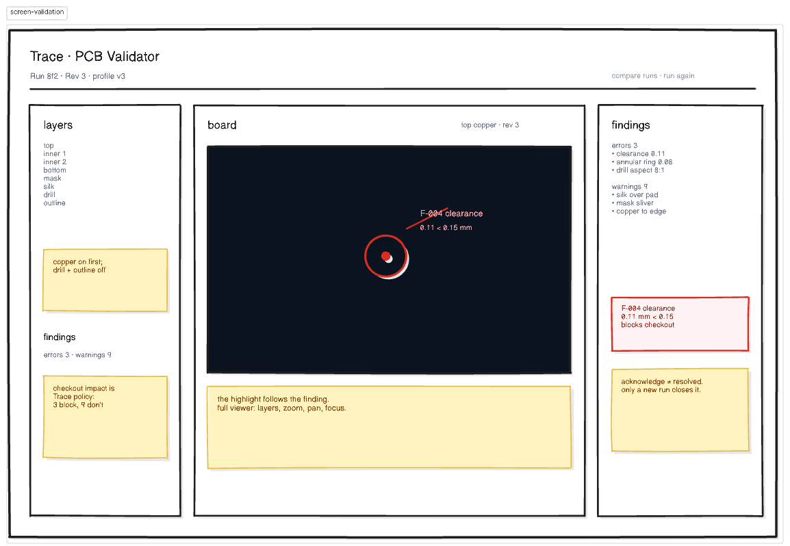
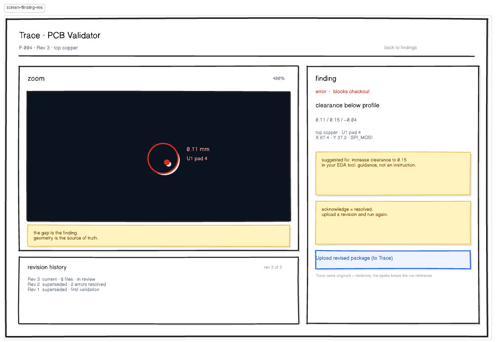
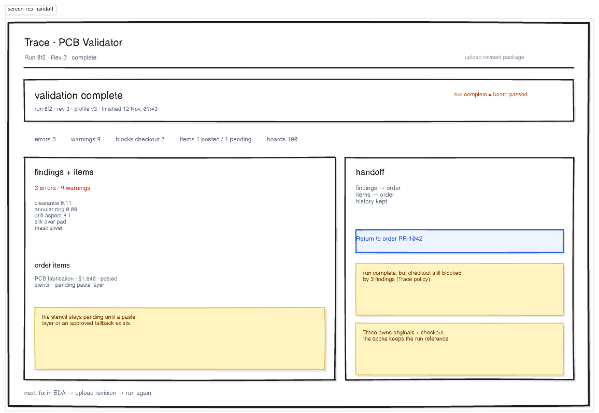
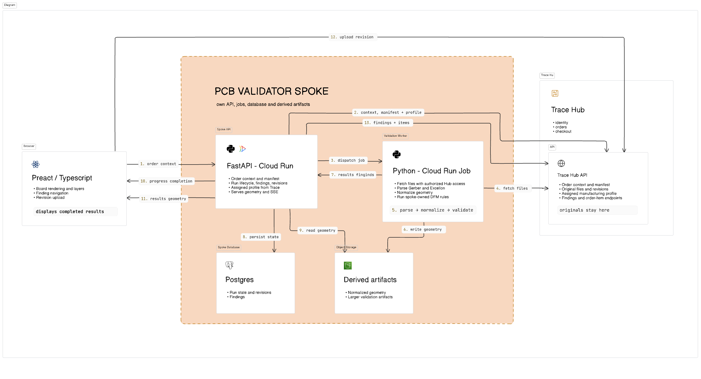

# PCB Validator design

Design documentation for the PCB Validator, a Trace spoke.

The full interactive architecture and wireframes are in the [Eraser workspace](https://app.eraser.io/workspace/gZ2nPy1ugw4zg50T2aL1?origin=share).

## Docs

- [Product](docs/product.md) — customer-facing capabilities and behavior.
- [Scope](docs/scope.md) — core workflow, boundaries and ownership.
- [Architecture](docs/architecture.md) — components, data flows and architectural rules.
- [Decision notes](docs/decision-notes.md) — trade-offs, alternatives and non-goals.
- [Mockups](docs/mockups.md) — screen-by-screen wireframes and their rationale.
- [AI usage](docs/ai.md) — how AI was used in this project.

## Screens

### 1. Package overview

Order context, files, detection and processing status.

This screen is the first trust boundary. The order supplies a four-layer package, so all four copper layers are listed and mapped explicitly. Anything the package does not prove, such as drill plating or a missing paste layer, is shown as a question instead of silently assumed. The manufacturing profile is assigned to the order and the ruleset belongs to the spoke, so the customer sees both versions but cannot change them here. Uploading a revised package adds a revision to the order; it does not replace the current revision or its results. The board on this screen is illustrative until normalization finishes; the viewer renders parsed geometry after the run.

### 2. Validation workspace

Board viewer, layer control and the findings wall.

View wireframe

The board and the findings stay in one view, because the customer needs to compare a measurement with the geometry that produced it. Selecting a finding is a local action: it highlights and zooms the board without re-running validation. Findings are grouped by technical severity, while checkout impact is shown separately because Trace owns that policy. The profile belongs to the order and the ruleset belongs to the spoke, so both are read-only here.

### 3. Finding resolution

One issue, its geometry and what to change in the EDA tool.

View wireframe

This is a focused state of the workspace, not a separate editor, and the customer still fixes the board in their EDA tool. The finding states the constraint, the measured geometry, and a suggested remediation framed as guidance. Acknowledgement is tracked separately from resolution: a finding only closes when a later validation run confirms it, never because someone checked a box. Trace owns the original files and revision manifest. The spoke stores the revision reference, content hash, and derived results for each run.

### 4. Results and handoff

Findings posted back to Trace, order items posted, and return to the order.

View wireframe

The spoke reports and the hub decides. A run can complete while findings that block checkout remain, so checkout eligibility stays a hub policy rather than something the validator grants. The spoke posts findings and the priceable items it can actually derive from the package, keeps the derived data needed to re-render the board, and leaves cost roll-up, checkout and production tracking to Trace.

## Architecture diagram

